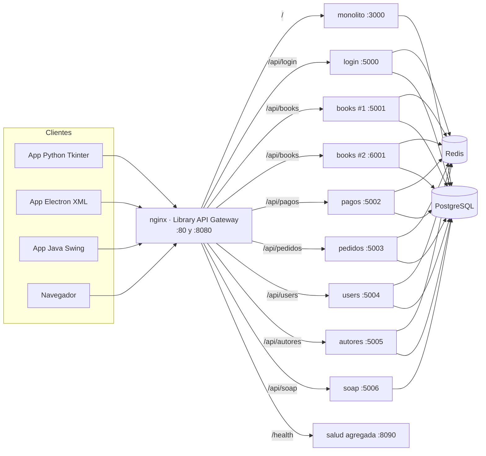

# Library API Gateway (reverse proxy con nginx)

Un **único punto de entrada** para los clientes de Library. Las tres apps de escritorio (Python Tkinter, Electron y Java Swing) y el navegador ya no llaman a cada microservicio en su puerto: llaman a **nginx**, que enruta, balancea, limita, registra y responde los errores de forma uniforme.

- **Instancia:** GCP `34.135.84.31` (CentOS Stream 10, nginx 1.26). Sin dominio: se usa la IP.
- **Puertos expuestos:** solo **80** (web + API, como la demo de clase) y **8080** (solo API, requisito RF1), además de SSH. Todo lo demás escucha en `127.0.0.1`.

## Antes y después

```
ANTES: cada app conoce y llama a cada puerto (8 puertos abiertos a Internet)

  App Python ──┬──► :5000 login   :5001 books   :5002 pagos
  App Electron ┼──► :5003 pedidos :5004 users   :5005 autores   :5006 soap
  Navegador ───┴──► :80 nginx /library/ ──► :3000 monolito

DESPUÉS: una sola puerta; los servicios solo escuchan en 127.0.0.1

  App Python ──┐                     ┌─► /             → monolito  127.0.0.1:3000
  App Electron ┼─► nginx :80 / :8080 ┼─► /api/login/   → login     127.0.0.1:5000
  App Java ────┤   (Library API      ├─► /api/books/   → books     127.0.0.1:5001 ┐ round
  Navegador ───┘    Gateway)         │                             127.0.0.1:6001 ┘ robin
                                     ├─► /api/pagos/   → pagos     127.0.0.1:5002
                                     ├─► /api/pedidos/ → pedidos   127.0.0.1:5003
                                     ├─► /api/users/   → users     127.0.0.1:5004
                                     ├─► /api/autores/ → autores   127.0.0.1:5005
                                     ├─► /api/soap/    → soap      127.0.0.1:5006
                                     └─► /health       → salud agregada 127.0.0.1:8090
```



## Rutas (estilo A de la clase: el prefijo se quita antes de reenviar)

| El cliente llama a | nginx reenvía a | Instancias |
|---|---|---|
| `http://34.135.84.31/` | monolito `/` | 127.0.0.1:3000 |
| `…/api/login/login` | login `/login` (límite estricto: 30/min por IP) | 127.0.0.1:5000 |
| `…/api/books/books?format=json` | books `/books?format=json` | **127.0.0.1:5001 y 127.0.0.1:6001** |
| `…/api/pagos/payments` | pagos `/payments` | 127.0.0.1:5002 |
| `…/api/pedidos/orders` | pedidos `/orders` | 127.0.0.1:5003 |
| `…/api/users/users` | users `/users` | 127.0.0.1:5004 |
| `…/api/autores/authors` | autores `/authors` | 127.0.0.1:5005 |
| `…/api/soap/books` | soap `/books` (XML) | 127.0.0.1:5006 |
| `…/health` | salud agregada | 127.0.0.1:8090 |
| `/library/...` (URL antigua) | redirección 301 a `/...` | — |

Las mismas rutas funcionan en `http://34.135.84.31:8080/api/...`; en el 8080 la raíz `/` es 404 porque solo hay API.

## Configuración de nginx (archivos de esta carpeta)

| Archivo en el repo | Se instala en | Contenido |
|---|---|---|
| `nginx/library-gateway.conf` | `/etc/nginx/conf.d/` | `map` (request id y servicio), límites `limit_req_zone`, formato de registro, **upstreams** (con `zone`, `max_fails=2 fail_timeout=10s`) y el servidor **:8080** |
| `nginx/library-web.conf` | `/etc/nginx/conf.d/` | Servidor **:80**: monolito en `/`, API en `/api/...`, redirección de `/library/` |
| `nginx/rutas-api.conf` | `/etc/nginx/library-gateway/` | Lo común a ambos puertos: tabla de rutas, cabeceras `X-Forwarded-*` y `X-Request-ID`, timeouts (3 s conexión, 10 s respuesta), reintento en la otra instancia, errores JSON (404, 429, 503, 504) y `/health` |
| `salud/salud_gateway.py` + `systemd/library-gateway-salud.service` | `/opt/library-gateway/`, `/etc/systemd/system/` | Salud agregada (RF5): consulta en paralelo el `/health` de cada instancia; `200 ok` o `503 degraded` |
| `systemd/library-books-2.service` + `config/books-2.env` | `/etc/systemd/system/`, `/etc/library-gateway/` | Segunda instancia de books en el 6001: mismo código y `.env`, solo cambia `BOOKS_PORT` |
| `config/gateway.env` | `/etc/library-gateway/` | Instancias y tiempos de la salud agregada (sin secretos) |
| `desplegar.sh` | — | Instala o actualiza todo lo anterior; ejecuta `nginx -t` antes de recargar |

Instalación o actualización en la instancia:

```bash
sudo bash gateway/desplegar.sh
```

Además, en la instancia cada servicio tiene `HOST=127.0.0.1` en su `.env` (ver los `.env.example`), y el firewall de GCP solo permite 22, 80 y 8080. Todos los servicios están habilitados en systemd: arrancan solos al encender la instancia y se detienen en orden al apagarla.

## Qué hace el gateway

| Función | Cómo | Comprobado con |
|---|---|---|
| Enrutamiento por prefijo | `location /api/<svc>/ { proxy_pass http://gw_<svc>/; }` | `tests/test_gateway.py` |
| Reenvío intacto (método, query, cuerpo, cookies, `Authorization`) | comportamiento de nginx; `proxy_redirect` corrige el `Location` del POST | `tests/test_gateway.py` |
| Balanceo round robin | `upstream gw_books` con 2 servidores y `zone` compartida | `pruebas_falla.ps1` (5001, 6001, 5001, 6001…) |
| Instancia caída: fuera de rotación + reintento | `max_fails=2 fail_timeout=10s`, `proxy_next_upstream error timeout` | `pruebas_falla.ps1` (con 5001 apagada todo da 200) |
| Salud agregada | `salud_gateway.py` | `GET /health` → 200 ok / 503 degraded |
| Errores uniformes en JSON con `request_id` | `error_page` → `@gw_404/429/503/504` | 404, 429, 503 (pagos caído), 504 (pagos congelado, 10 s) |
| `X-Request-ID` + una línea de registro por petición | `map $http_x_request_id`, `log_format gw_registro` → `/var/log/nginx/gateway.log` | `evidencias/registro_gateway_muestra.txt` |
| Límite de tasa por IP | `limit_req` 20 r/s (ráfaga 40); login 30/min (ráfaga 20) | `prueba_limite.py`: 120 peticiones → 52×200, 68×429 |

## Pruebas y evidencias

| Archivo | Qué demuestra |
|---|---|
| `tests/test_gateway.py` | 18 pruebas funcionales a través del gateway (rutas, query, cookie, Bearer, POST/PATCH/DELETE, Location, round robin, salud, request id, errores). Pasan en :80 y en :8080 |
| `pruebas_falla.ps1` → `evidencias/pruebas_falla_*.txt` | Round robin, instancia caída, pagos caído (503), pagos congelado (504), ruta inexistente (404), recuperación |
| `prueba_limite.py` → `evidencias/prueba_limite.txt` | Límite de tasa: 429 con JSON |
| `evidencias/registro_gateway_muestra.txt` | Líneas del registro de nginx con request id, servicio, instancia, código y tiempo |
| `locust_comparar.ps1` → `evidencias/locust/` | Mismo escenario de Locust directo frente a gateway (CSV, HTML) |
| `evidencias/conexiones_directo_vs_gateway.txt` | Por qué el gateway fue más rápido: `Connection: close` (Flask) frente a `keep-alive` (nginx) |
| `evidencias/acceso_directo_cerrado.txt` | Desde fuera, los puertos directos ya no responden; el gateway sí |
| `evidencias/capturas_app_python/` | App Tkinter funcionando solo con el gateway (12 capturas) |
| `evidencias/capturas_app_electron/` | App Electron leyendo el catálogo por `/api/soap` + lista real de URLs pedidas |
| `evidencias/capturas_app_java/` | App Java funcionando solo con el gateway |

Ejecutar las pruebas (requiere Python con `requests` y `pytest`; credenciales solo en variables de la terminal):

```powershell
$env:GATEWAY_URL = 'http://34.135.84.31'          # o http://34.135.84.31:8080
$env:GATEWAY_EMAIL = '<correo admin>'; $env:GATEWAY_PASSWORD = Read-Host 'Contraseña'
python -m pytest -v gateway/tests/test_gateway.py
powershell -ExecutionPolicy Bypass -File gateway/pruebas_falla.ps1
python gateway/prueba_limite.py
```

## Resultados de carga (Locust, mismo escenario `MicroserviciosUser`)

| Perfil | Vía | Peticiones | Fallas | p50 | p95 | RPS |
|---|---|---|---|---|---|---|
| Load (5 usuarios, 2 min) | Directo | 288 | 0 | 120 ms | 170 ms | 2.39 |
| Load | **Gateway** | 305 | 0 | **63 ms** | **120 ms** | 2.51 |
| Stress (2→20 usuarios) | Directo | 487 | 0 | 140 ms | 230 ms | 5.37 |
| Stress | **Gateway** | 495 | 0 | **63 ms** | **140 ms** | 5.41 |

Pasar por el gateway fue **más rápido**. El salto extra ocurre dentro de la VM y cuesta menos de 1 ms, mientras que nginx mantiene viva la conexión con el cliente (`keep-alive`). En directo, el servidor de desarrollo de Flask responde `Connection: close` y cada petición abre una conexión TCP nueva desde la laptop. Lo confirmamos con `curl`: en directo hubo 1 conexión nueva por petición (~125 ms); por el gateway, 0 conexiones nuevas desde la segunda petición (~60 ms).

## Clientes adaptados

| App | Cambio | Dirección por defecto |
|---|---|---|
| Python Tkinter (`apps/Python_app`) | Acepta URLs con prefijo `/api/<servicio>`; valores por defecto al gateway | `http://34.135.84.31/api/<servicio>` |
| Electron (`apps/electron-catalog`) | Solo la URL base | `http://34.135.84.31/api/soap` + `/books` |
| Java Swing (`apps/java-desktop`, nueva) | Configura solo la dirección del gateway | `http://34.135.84.31` |

No se modificó la lógica de ningún microservicio ni del monolito, como pide el proyecto.
